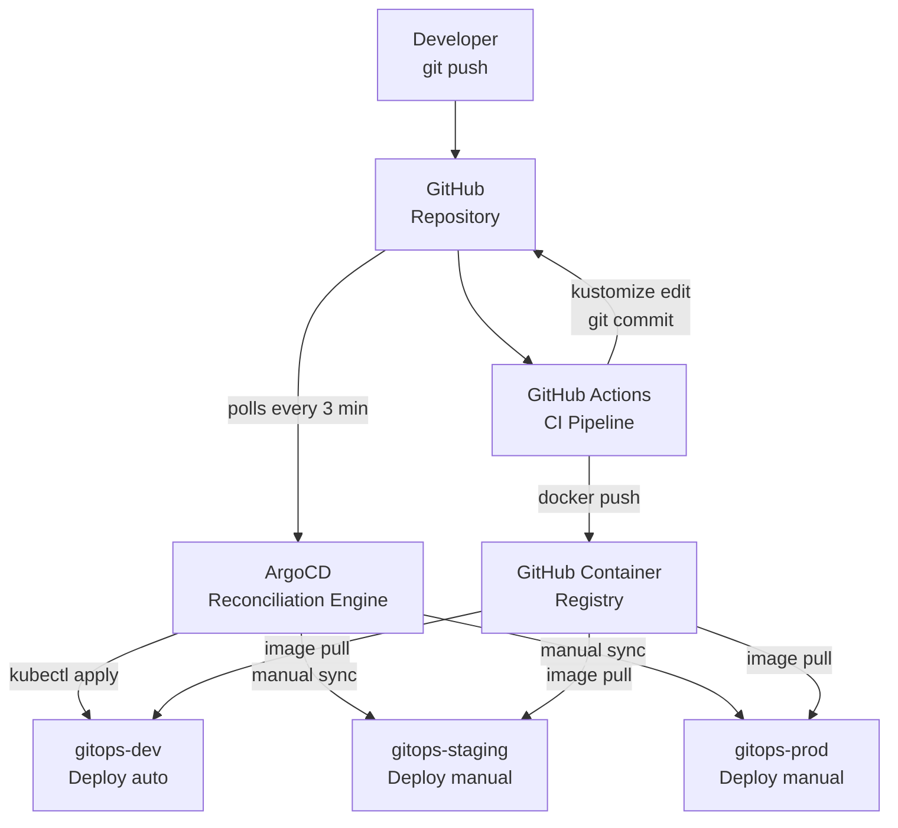
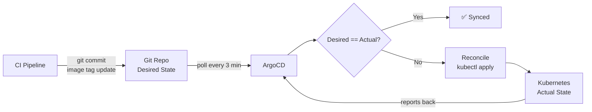

# GitOps CI/CD Pipeline

> A production-grade GitOps CI/CD pipeline demonstrating end-to-end software delivery automation with GitHub Actions, ArgoCD, Kubernetes, and a full observability stack — runnable on a single machine with Kind.

[](https://github.com/Parzivalart3mis/gitops-cicd-pipeline/actions/workflows/ci.yml)
[](LICENSE)
[](https://argo-cd.readthedocs.io/)
[](https://kubernetes.io/)
[](https://www.python.org/)

---

## Table of Contents

- [Architecture Overview](#architecture-overview)
- [The GitOps Loop](#the-gitops-loop)
- [Tech Stack](#tech-stack)
- [Quick Start](#quick-start)
- [Repository Structure](#repository-structure)
- [CI Pipeline](#ci-pipeline)
- [Environment Promotion](#environment-promotion)
- [Rollback Strategy](#rollback-strategy)
- [Security Features](#security-features)
- [Observability](#observability)
- [Design Decisions](#design-decisions)
- [DORA Metrics](#dora-metrics)
- [Future Improvements](#future-improvements)

---

## Architecture Overview



The system is built around one principle: **Git is the single source of truth for what should be running in every environment.** No tool pushes directly to Kubernetes — ArgoCD continuously reconciles the cluster state with what Git declares.

---

## The GitOps Loop

### Pull-based vs Push-based deployment

| Approach | Who deploys | How |
|----------|------------|-----|
| **Push-based** (traditional CI) | CI pipeline | Runs `kubectl apply` or `helm upgrade` directly |
| **Pull-based** (GitOps) | ArgoCD (in-cluster) | Watches Git; reconciles cluster to match |

**Why pull-based is better for production:**

1. **Auditability** — Every cluster change is a Git commit with author, timestamp, and diff
2. **Rollback** — `git revert` rolls back any deployment; ArgoCD resyncs automatically
3. **Drift detection** — ArgoCD alerts when someone makes manual `kubectl` changes (drift from Git)
4. **Security** — CI never needs `kubectl` credentials; ArgoCD holds them inside the cluster
5. **Single source of truth** — The cluster state is always derivable from the Git history

### The Loop Visualised



---

## Tech Stack

| Tool | Version | Role | Why this tool |
|------|---------|------|--------------|
| **GitHub Actions** | latest | CI pipeline | Native GitHub integration; free for public repos; matrix jobs |
| **ArgoCD** | v2.11 | GitOps CD controller | Best-in-class GitOps UI; ApplicationSets; self-heal; drift detection |
| **Kubernetes** | v1.30 | Container orchestration | Industry standard; full production feature set |
| **Kind** | v0.23 | Local Kubernetes | Runs K8s in Docker; multi-node; no VM overhead |
| **Kustomize** | v5.4 | Manifest management | Built into kubectl; no templating; pure YAML overlays |
| **Helm** | v3.15 | Third-party tool installs | ArgoCD, Prometheus, Grafana all ship well-maintained Helm charts |
| **FastAPI** | 0.111 | Backend framework | Auto OpenAPI docs; async; typed; Prometheus instrumentation |
| **Nginx** | 1.27 | Frontend server | Minimal attack surface; excellent caching/compression config |
| **Prometheus** | v2.53 | Metrics collection | De-facto Kubernetes monitoring standard |
| **Grafana** | v11 | Metrics visualisation | Rich dashboards; AlertManager integration |
| **Bitnami Sealed Secrets** | v0.27 | Secrets management | Encrypt-once, commit-safely; no Vault complexity needed |
| **OPA Gatekeeper** | v3.16 | Admission control | Policy-as-code; blocks bad resources before they reach etcd |
| **Trivy** | latest | Security scanning | Fast; covers OS, pip, npm, misconfig, secrets in one tool |

---

## Quick Start

### Prerequisites

| Tool | Version | Install |
|------|---------|---------|
| Docker | ≥ 24.0 | [docs.docker.com](https://docs.docker.com/get-docker/) |
| kubectl | ≥ 1.28 | [kubernetes.io/docs/tasks/tools](https://kubernetes.io/docs/tasks/tools/) |
| kind | ≥ 0.23 | [kind.sigs.k8s.io](https://kind.sigs.k8s.io/docs/user/quick-start/) |
| helm | ≥ 3.15 | [helm.sh](https://helm.sh/docs/intro/install/) |
| kustomize | ≥ 5.4 | [kubectl.docs.kubernetes.io](https://kubectl.docs.kubernetes.io/installation/kustomize/) |

### One-command setup

```bash
git clone https://github.com/Parzivalart3mis/gitops-cicd-pipeline.git
cd gitops-cicd-pipeline

# Create Kind cluster + install ArgoCD + Prometheus + Grafana + OPA
make setup
```

This takes approximately 5–10 minutes on first run (image pulls).

### Access the UIs

```bash
make port-forward
```

| UI | URL | Credentials |
|----|-----|-------------|
| ArgoCD | http://localhost:8080 | admin / `kubectl -n argocd get secret argocd-initial-admin-secret -o jsonpath="{.data.password}" \| base64 -d` |
| Grafana | http://localhost:3000 | admin / gitops-demo-admin |
| Backend API | http://localhost:8000/docs | — |
| Frontend | http://localhost:8888 | — |

### Watch the full pipeline demo

```bash
make demo
```

This script builds a new image, loads it into Kind, updates the overlay, and shows ArgoCD syncing the new version — all with coloured explanations at each step.

---

## Repository Structure

```
.
├── .github/workflows/
│   ├── ci.yml              ← Main CI: lint → test → scan → build → update-manifests
│   ├── promote.yml         ← Manual env promotion: dev → staging → prod
│   └── rollback.yml        ← Emergency rollback with GitHub Issue audit trail
├── apps/
│   ├── backend/            ← FastAPI REST API (Python 3.12)
│   │   ├── Dockerfile.multistage
│   │   └── src/
│   │       ├── main.py     ← App entry point + /healthz /readyz
│   │       ├── routes/     ← CRUD endpoints
│   │       ├── models/     ← Pydantic schemas
│   │       └── tests/      ← pytest suite (≥80% coverage enforced)
│   └── frontend/           ← Nginx + plain HTML/JS UI
│       ├── Dockerfile.multistage
│       ├── nginx.conf      ← Security headers + gzip + caching
│       └── src/index.html  ← Displays deployment version from /healthz
├── k8s/
│   ├── base/               ← Kustomize base (deployment, service, HPA, PDB, NetworkPolicy)
│   └── overlays/
│       ├── dev/            ← 1 replica, debug log, auto-sync
│       ├── staging/        ← 2 replicas, info log, manual sync
│       └── prod/           ← 3 replicas, warn log, PDB minAvailable=2, manual sync
├── argocd/
│   ├── applications/       ← ArgoCD Application CRDs (dev/staging/prod)
│   ├── applicationsets/    ← ApplicationSet (generates all envs from a template)
│   ├── install/            ← ArgoCD Helm values
│   └── projects/           ← AppProject RBAC (scoped source repos + destinations)
├── observability/
│   ├── prometheus/         ← kube-prometheus-stack values + alert rules + ServiceMonitor
│   ├── grafana/            ← Grafana values + pre-built dashboards
│   └── loki/               ← Log aggregation values
├── security/
│   ├── trivy/              ← Trivy scan config
│   ├── sealed-secrets/     ← Controller Helm values
│   ├── kubesec/            ← Manifest scoring policy
│   └── opa-gatekeeper/     ← ConstraintTemplates + Constraints
├── scripts/
│   ├── setup-cluster.sh    ← One-command cluster bootstrap (idempotent)
│   ├── teardown-cluster.sh ← Clean cluster deletion
│   ├── demo.sh             ← Automated end-to-end demo
│   ├── port-forward.sh     ← Expose all UIs on localhost
│   └── seal-secret.sh      ← Helper to encrypt secrets with kubeseal
├── docs/
│   ├── architecture.md
│   ├── BRANCHING_STRATEGY.md
│   ├── ENVIRONMENT_PROMOTION.md
│   ├── ROLLBACK_PROCEDURES.md
│   ├── SECURITY.md
│   ├── TROUBLESHOOTING.md
│   └── diagrams/           ← Mermaid source files
└── Makefile                ← All common commands
```

---

## CI Pipeline

Four jobs run sequentially on every push to `main`:

```
lint-and-test → security-scan → build-and-push → update-manifests
```

### Job 1: lint-and-test

Runs in parallel for `backend` and `frontend` via GitHub Actions matrix:

- **Backend**: `ruff` linting, `mypy` type checking, `pytest` with ≥80% coverage enforcement
- **Frontend**: Nginx config validation via Docker
- **Shared**: Kustomize overlay validation (`kustomize build` all three overlays), shellcheck on scripts

### Job 2: security-scan

- **Trivy** filesystem scan — source code CVEs and exposed secrets
- **safety** — Python dependency CVE check
- **kubesec** — Kubernetes manifest security scoring (fails on negative score)
- Results uploaded to GitHub Security tab as SARIF

### Job 3: build-and-push

_(Only on push to `main`, not PRs)_

- Multi-stage Docker build (test stage runs first; fails if tests fail)
- Pushes three tags: `:<sha>` (immutable), `:<branch>`, `:latest`
- Post-build Trivy image scan — `CRITICAL` vulnerabilities fail the build
- Docker layer caching via GitHub Actions cache

### Job 4: update-manifests

_(Only on push to `main`)_

- Runs `kustomize edit set image` on `k8s/overlays/dev/`
- Updates `git_sha` in the dev env-config patch (so `/healthz` shows the right SHA)
- Commits: `chore(deploy): update dev images to <SHA>`
- Pushes to `main` → **this commit triggers ArgoCD to sync dev**

---

## Environment Promotion

```
Code Push → [CI] → dev (auto) → [manual] → staging → [manual + approval] → prod
```

### Promoting to staging

```bash
# Via GitHub Actions UI: Actions → Promote Environment → Run workflow
# Or interactively:
make promote
```

The `promote.yml` workflow validates the path (`dev → staging` only; `dev → prod` is blocked), updates `k8s/overlays/staging/kustomization.yaml`, and commits the change. A human then triggers the ArgoCD sync.

### Promoting to production

Same flow as staging, but `source_env: staging` and `target_env: prod`. The AppProject blocks weekend production syncs (configurable sync windows).

See [docs/ENVIRONMENT_PROMOTION.md](docs/ENVIRONMENT_PROMOTION.md) for detailed steps.

---

## Rollback Strategy

Three mechanisms, in order of preference:

1. **GitOps rollback** (recommended): `rollback.yml` workflow → updates overlay → ArgoCD syncs → creates GitHub Issue for audit trail
2. **`kubectl rollout undo`**: Fast but creates drift (follow up with Method 1)
3. **`git revert`**: Reverts the manifest commit; ArgoCD auto-syncs

```bash
# Interactive rollback via Makefile
make rollback

# Or trigger the GitHub Actions workflow:
# Actions → Rollback → environment=prod, target_tag=a1b2c3d, reason="High error rate after v1.2.3"
```

See [docs/ROLLBACK_PROCEDURES.md](docs/ROLLBACK_PROCEDURES.md) for detailed procedures and MTTR targets.

---

## Security Features

### Container Security

| Control | Implementation |
|---------|---------------|
| Non-root user | `runAsNonRoot: true`, `runAsUser: 1000`, `USER appuser` in Dockerfile |
| Read-only filesystem | `readOnlyRootFilesystem: true` (backend uses `/tmp` emptyDir) |
| Drop all capabilities | `capabilities.drop: [ALL]` |
| No privilege escalation | `allowPrivilegeEscalation: false` |
| Seccomp profile | `seccompProfile.type: RuntimeDefault` |
| No automount SA token | `automountServiceAccountToken: false` |

### Secrets Management (Sealed Secrets)

```
1. Create secret locally     → kubectl create secret ... --dry-run -o yaml
2. Encrypt with kubeseal     → ./scripts/seal-secret.sh gitops-dev myapp key=val
3. Commit SealedSecret       → git add k8s/overlays/dev/sealed-secret.yaml
4. Controller decrypts       → creates real Secret in-cluster
5. Pod consumes real Secret  → env var or volume mount
```

No plaintext secrets ever touch Git.

### OPA Gatekeeper Policies

Three admission control policies enforced at the API server:

| Policy | Scope | Effect |
|--------|-------|--------|
| `K8sRequiredLabels` | All namespaces | Deployments/Services must have `app` and `team` labels |
| `K8sBlockLatestImage` | staging, prod | Containers cannot use `:latest` image tag |
| `K8sRequiredResourceLimits` | All namespaces | All containers must specify CPU + memory requests and limits |

---

## Observability

### Metrics (Prometheus + Grafana)

The FastAPI backend exposes Prometheus-compatible metrics at `/metrics` via `prometheus-fastapi-instrumentator`. Prometheus scrapes all pods with the `prometheus.io/scrape: "true"` annotation.

**Pre-built Grafana dashboard** (`observability/grafana/dashboards/ci-cd-dashboard.json`) includes:

- HTTP request rate by environment
- p50/p95/p99 latency
- 5xx error rate
- Pod restart count
- CPU/memory utilisation vs limits
- Ready replicas vs desired replicas

### Alerting

| Alert | Condition | Severity |
|-------|-----------|---------|
| `HighPodRestartRate` | >3 restarts/hour | warning |
| `DeploymentReplicasMismatch` | ready ≠ desired for 10m | critical |
| `DeploymentRolloutStuck` | Progressing=false for 15m | critical |
| `PodOOMKilled` | container terminated with OOMKill | warning |
| `ArgoCDAppOutOfSync` | OutOfSync for 30m | warning |
| `HighErrorRate` | >5% 5xx rate for 5m | critical |
| `HighRequestLatency` | p99 > 2s for 5m | warning |

### Structured Logging

The backend uses `structlog` for JSON-structured logs:

```json
{"level": "info", "logger": "src.routes.items", "timestamp": "2024-01-15T10:30:00Z", "event": "create_item", "item_id": "uuid", "name": "Widget"}
```

Loki + Promtail aggregates these logs. Query in Grafana: `{namespace="gitops-prod"} | json | level="error"`.

---

## Design Decisions

### Why Kustomize over Helm for application manifests?

Kustomize uses **strategic merge patches** on plain YAML. The diff between base and overlay is trivially readable in PRs. Helm templates require understanding Go templating and the chart's value schema before you can reason about what will be deployed. For in-house application manifests that your team owns, Kustomize produces more reviewable, less surprising output.

Helm *is* used for third-party tools (ArgoCD, Prometheus, Grafana, Sealed Secrets) where the charts are well-maintained and the complexity is encapsulated.

### Why Kind over Minikube?

Kind creates real multi-node clusters (simulating control plane + worker separation) using Docker containers as nodes. Minikube defaults to a single node and has more complex driver considerations. Kind starts faster, uses less memory, and its multi-node config is expressed as a simple YAML file — easy to version-control and reproduce.

### Why monorepo?

Application code, Kubernetes manifests, CI workflows, and observability configs live together because they evolve together. When you add a new endpoint to the backend, you often need to update the Kustomize manifests, CI pipeline, and alert rules in the same PR. A monorepo makes these cross-cutting changes atomic and reviewable in a single PR.

### Why Sealed Secrets over Vault?

Vault is the right choice for a large organisation with multiple teams, complex secret rotation needs, and dedicated platform engineering resources. For a single-team portfolio project, Sealed Secrets achieves the key goal (no plaintext secrets in Git) with a single controller, no external dependencies, and a two-command workflow. The cryptographic model (public/private key pair, controller holds private key) is sound.

### Why Python/FastAPI for the backend?

The backend is intentionally trivial — the pipeline is the product, not the app. FastAPI was chosen because:
- Auto-generated OpenAPI docs make the API self-documenting
- `prometheus-fastapi-instrumentator` provides Prometheus metrics with one line
- `structlog` produces JSON-structured logs with one import
- `pytest` + `TestClient` makes testing fast and straightforward

---

## DORA Metrics

This pipeline is designed to optimise the four DORA (DevOps Research and Assessment) metrics:

| Metric | How this pipeline helps | Target |
|--------|------------------------|--------|
| **Deployment Frequency** | Every push to `main` auto-deploys to dev; promotion to staging/prod is one workflow trigger | Multiple times per day |
| **Lead Time for Changes** | CI pipeline takes ~5 min; ArgoCD syncs within ~3 min of manifest commit | < 10 minutes to dev |
| **Change Failure Rate** | Tests + security scan + OPA policies prevent bad deployments; ≥80% test coverage enforced | < 5% |
| **MTTR** | GitOps rollback + ArgoCD sync = previous version running in < 10 minutes | < 10 minutes |

---

## Future Improvements

The following features are intentionally out-of-scope for this portfolio project but represent natural next steps in a production evolution:

- **Canary deployments** — Argo Rollouts for traffic-split canary releases (5% → 25% → 100%)
- **Integration testing in staging** — Run a test suite against staging before promoting to prod
- **Slack notifications** — ArgoCD Notifications controller → `#deployments` channel
- **Multi-cluster** — ArgoCD managing separate dev/staging/prod clusters (not just namespaces)
- **Terraform** — Infrastructure-as-Code for the cloud environment (VPC, EKS, IAM roles)
- **Cost monitoring** — Kubecost to attribute resource costs per namespace/team
- **SBOM generation** — Syft to generate a Software Bill of Materials for each release
- **Policy-as-Code testing** — `conftest` + OPA unit tests for Rego policies
- **Progressive delivery** — Feature flags (Flagsmith/LaunchDarkly) for decoupling deploy from release

---

## Resources

- [GitOps Principles](https://opengitops.dev/) — The OpenGitOps working group's formal definition
- [ArgoCD Documentation](https://argo-cd.readthedocs.io/)
- [Kustomize Documentation](https://kubectl.docs.kubernetes.io/guides/config_management/)
- [Sealed Secrets](https://github.com/bitnami-labs/sealed-secrets)
- [OPA Gatekeeper](https://open-policy-agent.github.io/gatekeeper/)
- [DORA Research](https://dora.dev/research/) — The State of DevOps Report

---

## License

[MIT](LICENSE) © Parzivalart3mis
