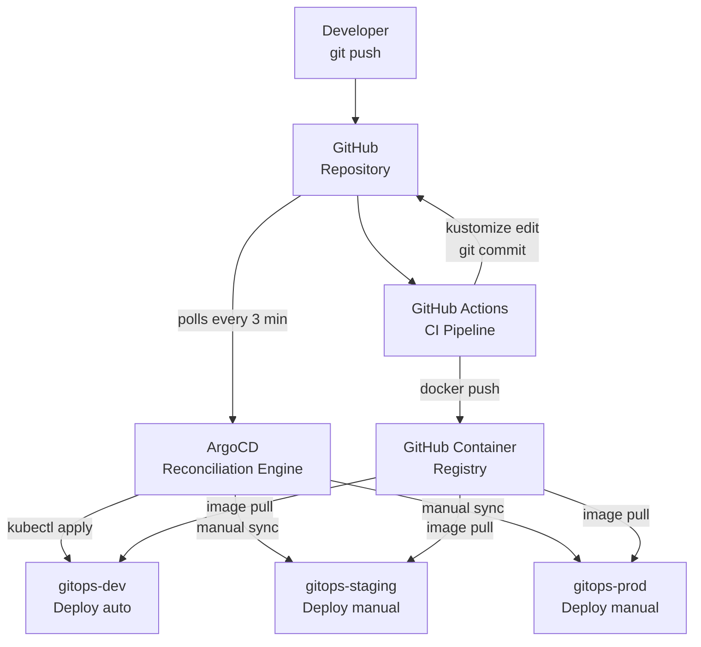
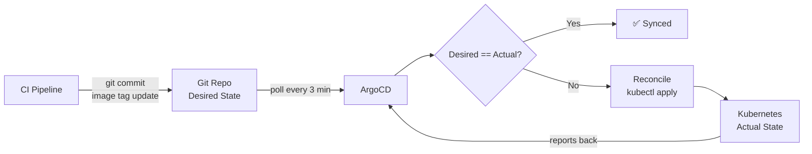

# GitOps CI/CD Pipeline

> A production-grade GitOps CI/CD pipeline demonstrating end-to-end software delivery automation with GitHub Actions, ArgoCD, Kubernetes, and a full observability stack — runnable on a single machine with Kind.

[](https://github.com/Parzivalart3mis/gitops-cicd-pipeline/actions/workflows/ci.yml)
[](LICENSE)
[](https://argo-cd.readthedocs.io/)
[](https://kubernetes.io/)
[](https://www.python.org/)

---

## Table of Contents

- [Architecture Overview](#architecture-overview)
- [The GitOps Loop](#the-gitops-loop)
- [Tech Stack](#tech-stack)
- [Quick Start](#quick-start)
- [Repository Structure](#repository-structure)
- [CI Pipeline](#ci-pipeline)
- [Environment Promotion](#environment-promotion)
- [Rollback Strategy](#rollback-strategy)
- [Security Features](#security-features)
- [Observability](#observability)
- [Design Decisions](#design-decisions)
- [DORA Metrics](#dora-metrics)
- [Future Improvements](#future-improvements)

---

## Architecture Overview



The system is built around one principle: **Git is the single source of truth for what should be running in every environment.** No tool pushes directly to Kubernetes — ArgoCD continuously reconciles the cluster state with what Git declares.

---

## The GitOps Loop

### Pull-based vs Push-based deployment

| Approach | Who deploys | How |
|----------|------------|-----|
| **Push-based** (traditional CI) | CI pipeline | Runs `kubectl apply` or `helm upgrade` directly |
| **Pull-based** (GitOps) | ArgoCD (in-cluster) | Watches Git; reconciles cluster to match |

**Why pull-based is better for production:**

1. **Auditability** — Every cluster change is a Git commit with author, timestamp, and diff
2. **Rollback** — `git revert` rolls back any deployment; ArgoCD resyncs automatically
3. **Drift detection** — ArgoCD alerts when someone makes manual `kubectl` changes (drift from Git)
4. **Security** — CI never needs `kubectl` credentials; ArgoCD holds them inside the cluster
5. **Single source of truth** — The cluster state is always derivable from the Git history

### The Loop Visualised



---

## Tech Stack

| Tool | Version | Role | Why this tool |
|------|---------|------|--------------|
| **GitHub Actions** | latest | CI pipeline | Native GitHub integration; free for public repos; matrix jobs |
| **ArgoCD** | v3.6 (chart 10.15) | GitOps CD controller | Best-in-class GitOps UI; ApplicationSets; self-heal; drift detection |
| **Kubernetes** | v1.30+ | Container orchestration | Industry standard; full production feature set |
| **Kind** | ≥ v0.23 | Local Kubernetes | Runs K8s in Docker; multi-node; no VM overhead |
| **Kustomize** | v5.8 | Manifest management | Built into kubectl; no templating; pure YAML overlays |
| **Helm** | v3.15+ | Third-party tool installs | ArgoCD, Prometheus, Grafana, Loki all ship maintained Helm charts |
| **FastAPI** | 0.162 | Backend framework | Auto OpenAPI docs; async; typed; Prometheus instrumentation |
| **Nginx** | 1.30 | Frontend server + same-origin API proxy | Minimal attack surface; excellent caching/compression config |
| **Prometheus** | v3.16 (kube-prometheus-stack 93.1) | Metrics collection | De-facto Kubernetes monitoring standard |
| **Grafana** | v13 | Metrics & log visualisation | Rich dashboards; AlertManager integration |
| **Loki + Grafana Alloy** | Loki 3.7 | Log aggregation | Label-indexed logs queried next to metrics in Grafana |
| **Sealed Secrets** | v0.41 (chart 2.22) | Secrets management | Encrypt-once, commit-safely; no Vault complexity needed |
| **OPA Gatekeeper** | v3.23 | Admission control | Policy-as-code; blocks bad resources before they reach etcd |
| **Trivy** | action v0.36 | Security scanning | Fast; covers OS, pip, npm, misconfig, secrets in one tool |

Every cluster component is pinned in [`scripts/versions.env`](scripts/versions.env); every third-party GitHub Action is pinned to a commit SHA.

---

## Quick Start

### Prerequisites

| Tool | Version | Install |
|------|---------|---------|
| Docker | ≥ 24.0 | [docs.docker.com](https://docs.docker.com/get-docker/) |
| kubectl | ≥ 1.28 | [kubernetes.io/docs/tasks/tools](https://kubernetes.io/docs/tasks/tools/) |
| kind | ≥ 0.23 | [kind.sigs.k8s.io](https://kind.sigs.k8s.io/docs/user/quick-start/) |
| helm | ≥ 3.15 | [helm.sh](https://helm.sh/docs/intro/install/) |
| kustomize | ≥ 5.4 | [kubectl.docs.kubernetes.io](https://kubectl.docs.kubernetes.io/installation/kustomize/) |

### One-command setup

```bash
git clone https://github.com/Parzivalart3mis/gitops-cicd-pipeline.git
cd gitops-cicd-pipeline

# Create Kind cluster + install ingress, metrics-server, Sealed Secrets,
# OPA Gatekeeper, Prometheus/Grafana/Loki/Alloy and ArgoCD
make setup
```

This takes approximately 5–10 minutes on first run (image pulls). ArgoCD then syncs **dev** automatically; staging and prod wait for a promotion (see below).

> Using your own fork? Update `repoURL` in `argocd/` and make your GHCR packages public (Kind pulls anonymously). The workflows derive the image owner from the repository automatically.

### Access the UIs

ArgoCD and Grafana are exposed on the host directly. The app is served through the Ingress on per-environment hosts; map them to localhost once:

```bash
make hosts    # prints the /etc/hosts line to add
```

| UI | URL | Credentials |
|----|-----|-------------|
| ArgoCD | http://localhost:30080 | admin / `kubectl -n argocd get secret argocd-initial-admin-secret -o jsonpath="{.data.password}" \| base64 -d` |
| Grafana | http://localhost:30300 | admin / gitops-demo-admin |
| Frontend (dev) | http://dev.gitops.local | — |
| Backend API (dev) | http://api.dev.gitops.local/docs | — |

No `/etc/hosts` edit? `make port-forward` exposes ArgoCD on :8080, Grafana on :3000, the dev backend on :8000 and the dev frontend on :8888. The frontend works either way: it calls the API through its own `/backend` reverse proxy.

### Watch the full pipeline demo

```bash
make demo
```

This script builds a new backend image, loads it into Kind, bumps the dev overlay (in a temp copy, never your working tree), rolls it out with zero downtime, verifies the version at `/healthz`, and then lets ArgoCD self-heal the un-committed change back to what Git declares, with coloured explanations at each step.

---

## Repository Structure

```
.
├── .github/workflows/
│   ├── ci.yml              ← Main CI: lint/test → scan → build → update-manifests
│   ├── promote.yml         ← Manual env promotion: dev → staging → prod
│   └── rollback.yml        ← Emergency rollback with GitHub Issue audit trail
├── .github/actions/setup-kustomize/ ← Pinned, checksum-verified kustomize
├── apps/
│   ├── backend/            ← FastAPI REST API (Python 3.12)
│   │   ├── Dockerfile.multistage  ← production stage copies from the test stage
│   │   ├── requirements.txt       ← runtime deps only
│   │   ├── requirements-dev.txt   ← pinned test/lint/audit tooling
│   │   └── src/
│   │       ├── main.py     ← App entry point + /healthz /readyz
│   │       ├── routes/     ← CRUD endpoints
│   │       ├── models/     ← Pydantic schemas
│   │       └── tests/      ← pytest suite (≥80% coverage enforced)
│   └── frontend/           ← Nginx + plain HTML/JS UI
│       ├── Dockerfile.multistage
│       ├── nginx.conf      ← Security headers + gzip + caching
│       ├── entrypoint.sh   ← Runtime config + /backend reverse proxy
│       └── src/index.html  ← Displays deployment version from /healthz
├── k8s/
│   ├── base/               ← Kustomize base (deployment, service, HPA, PDB, NetworkPolicy)
│   └── overlays/
│       ├── dev/            ← 1 replica (HPA 1–3), debug log, auto-sync
│       ├── staging/        ← 2 replicas (HPA 2–4), info log, manual sync
│       └── prod/           ← 3 replicas (HPA 3–6), warn log, PDB minAvailable=2, sized quota, manual sync
├── argocd/
│   ├── applications/       ← ArgoCD Applications (dev/staging/prod) — used by `make setup`
│   ├── applicationsets/    ← ApplicationSet alternative (same apps from one template; use one or the other)
│   ├── install/            ← ArgoCD Helm values
│   └── projects/           ← AppProject RBAC (scoped source repos + destinations)
├── observability/
│   ├── prometheus/         ← kube-prometheus-stack values + alert rules + ServiceMonitor
│   ├── grafana/            ← Grafana values + pre-built dashboards
│   └── loki/               ← Loki + Grafana Alloy values (log aggregation)
├── security/
│   ├── trivy/              ← Trivy scan config
│   ├── sealed-secrets/     ← Controller Helm values + example SealedSecret
│   ├── kubesec/            ← Manifest scoring policy
│   └── opa-gatekeeper/     ← templates/ (Rego) + constraints/ (where they apply)
├── scripts/
│   ├── setup-cluster.sh    ← One-command cluster bootstrap (idempotent)
│   ├── versions.env        ← Pinned versions of everything installed
│   ├── set-image-tag.sh    ← The deploy primitive: image tag + reported version, one edit
│   ├── get-image-tag.sh    ← What an overlay actually deploys (rendered)
│   ├── ci/                 ← push-overlay-change.sh (safe bot commits), validate-manifests.sh
│   ├── teardown-cluster.sh ← Clean cluster deletion
│   ├── demo.sh             ← Interactive end-to-end demo
│   ├── port-forward.sh     ← Expose all UIs on localhost
│   └── seal-secret.sh      ← Seal a secret and register it with an overlay
├── docs/
│   ├── architecture.md
│   ├── BRANCHING_STRATEGY.md
│   ├── ENVIRONMENT_PROMOTION.md
│   ├── ROLLBACK_PROCEDURES.md
│   ├── SECURITY.md
│   ├── TROUBLESHOOTING.md
│   └── diagrams/           ← Mermaid source files
└── Makefile                ← All common commands
```

---

## CI Pipeline

On every push to `master` (pull requests run everything up to the security scan):

```
backend ──┐
frontend ─┼─► security-scan ─► build-and-push ─► update-manifests
manifests ┘
```

### Stage 1: backend · frontend · manifests (parallel)

- **Backend**: `ruff`, `mypy`, `pytest` with ≥80% coverage of application code (tests excluded from the measurement)
- **Frontend**: builds the real image, runs `nginx -t` on its fully rendered config, and smoke-tests the container: security headers on every location type, the `/backend` proxy, placeholder substitution
- **Manifests**: `scripts/ci/validate-manifests.sh` renders every overlay and fails on warnings, non-lowercase image references, `images[]` entries that match nothing, tag/`git_sha` drift, duplicate Ingress hosts, or path-clobbering rewrites; `shellcheck` on all scripts

### Stage 2: security-scan (all blocking)

- **Trivy** filesystem scan — fixable CRITICAL/HIGH CVEs and committed secrets fail the build; the full report goes to the GitHub Security tab as SARIF
- **pip-audit** — Python dependency CVE check (runtime and dev tooling)
- **kubesec** — Deployment security scoring (fails on a negative score)

### Stage 3: build-and-push

_(Only on push, not PRs)_

- Multi-stage build; the backend's production stage copies its code from the test stage, so the tests run inside the build too
- The built container is smoke-tested (`/healthz` reports the commit, CRUD works, `/metrics` exports) and Trivy-scanned **before** anything is pushed — fixable `CRITICAL` vulnerabilities fail the build
- Pushes three tags: `:<sha>` (immutable, deployed), `:<branch>`, `:latest` (never deployed)
- Docker layer caching via GitHub Actions cache

### Stage 4: update-manifests

_(Only on push to the default branch, `master`)_

- `scripts/set-image-tag.sh` sets the dev image tags **and** the `git_sha` / `frontend_version` the app reports, in one edit
- `scripts/ci/push-overlay-change.sh` commits `chore(deploy): update dev images to <SHA>` on the latest tip of `master`, retries if another workflow pushed first, and skips if dev already runs a newer commit
- **This commit triggers ArgoCD to sync dev**

---

## Environment Promotion

```
Code Push → [CI] → dev (auto) → [manual] → staging → [manual + approval] → prod
```

### Promoting to staging

```bash
# Via GitHub Actions UI: Actions → Promote Environment → Run workflow
# Or interactively:
make promote
```

The `promote.yml` workflow validates the path (`dev → staging` only; `dev → prod` is blocked), promotes exactly the tag the source environment runs (leave `image_tag` empty), verifies both images exist in GHCR, updates `k8s/overlays/staging/`, and commits the change. A human then triggers the ArgoCD sync.

Until the first promotion, staging and prod carry a `latest` placeholder that OPA Gatekeeper rejects, so they can only ever run a promoted SHA.

### Promoting to production

Same flow as staging, with `source_env: staging` and `target_env: prod`. Add required reviewers to the `prod` GitHub Environment for an approval gate. The AppProject's sync window blocks automatic prod syncs on weekends, while still allowing manual syncs for emergencies.

See [docs/ENVIRONMENT_PROMOTION.md](docs/ENVIRONMENT_PROMOTION.md) for detailed steps.

---

## Rollback Strategy

Three mechanisms, in order of preference:

1. **GitOps rollback** (recommended): `rollback.yml` workflow → updates overlay → ArgoCD syncs → creates GitHub Issue for audit trail
2. **`kubectl rollout undo`**: Fast but creates drift (follow up with Method 1)
3. **`git revert`**: Reverts the manifest commit; ArgoCD auto-syncs dev (staging/prod need a manual sync)

```bash
# Interactive rollback via Makefile
make rollback

# Or trigger the GitHub Actions workflow:
# Actions → Rollback → environment=prod, target_tag=a1b2c3d, reason="High error rate after v1.2.3"
```

See [docs/ROLLBACK_PROCEDURES.md](docs/ROLLBACK_PROCEDURES.md) for detailed procedures and MTTR targets.

---

## Security Features

### Container Security

| Control | Implementation |
|---------|---------------|
| Non-root user | `runAsNonRoot: true`; backend UID 1000 (`USER 1000:1000` in the image), frontend UID 101 |
| Read-only filesystem | `readOnlyRootFilesystem: true` (backend uses `/tmp` emptyDir) |
| Drop all capabilities | `capabilities.drop: [ALL]` |
| No privilege escalation | `allowPrivilegeEscalation: false` |
| Seccomp profile | `seccompProfile.type: RuntimeDefault` |
| No automount SA token | `automountServiceAccountToken: false` |

### Secrets Management (Sealed Secrets)

```
1. Seal it for an environment → make seal-secret ENV=dev NAME=myapp DATA="key=@./value.txt"
   (builds the Secret client-side, encrypts it with kubeseal, writes
    k8s/overlays/dev/myapp.sealedsecret.yaml and registers it in the overlay)
2. Commit and push            → git add k8s/overlays/dev/ && git commit && git push
3. Controller decrypts        → creates the real Secret in-cluster
4. Pod consumes the Secret    → env var or volume mount
```

No plaintext secrets ever touch Git or disk. Ciphertext is bound to the cluster's controller key, so re-seal after recreating the Kind cluster.

### OPA Gatekeeper Policies

Three admission control policies enforced at the API server:

| Policy | Scope | Effect |
|--------|-------|--------|
| `K8sRequiredLabels` | gitops-* namespaces | Deployments/Services must have `app` and `team` labels |
| `K8sBlockLatestImage` | staging, prod | Containers must use an explicit tag or digest, never `:latest` |
| `K8sRequiredResourceLimits` | gitops-* namespaces | All containers must specify CPU + memory requests and limits |

ConstraintTemplates (`templates/`) are applied first and Constraints (`constraints/`) only after Gatekeeper has created their CRDs.

---

## Observability

### Metrics (Prometheus + Grafana)

The FastAPI backend exposes Prometheus-compatible metrics at `/metrics` via `prometheus-fastapi-instrumentator`. Prometheus scrapes it through a ServiceMonitor in every environment (and `/metrics` is not exposed on the Ingress). Argo CD's controller metrics are scraped too, which feeds the `ArgoCDAppOutOfSync` alert. metrics-server supplies CPU/memory to the HPAs.

**Pre-built Grafana dashboard** (`observability/grafana/dashboards/ci-cd-dashboard.json`, loaded automatically from a ConfigMap) includes:

- HTTP request rate by environment
- p50/p95/p99 latency
- 5xx error rate
- Pod restart count
- CPU/memory utilisation vs limits
- Ready replicas vs desired replicas

### Alerting

| Alert | Condition | Severity |
|-------|-----------|---------|
| `HighPodRestartRate` | >3 restarts/hour | warning |
| `DeploymentReplicasMismatch` | ready ≠ desired for 10m | critical |
| `DeploymentRolloutStuck` | Progressing=false for 15m | critical |
| `PodOOMKilled` | container terminated with OOMKill | warning |
| `ArgoCDAppOutOfSync` | OutOfSync for 30m | warning |
| `HighErrorRate` | >5% 5xx rate for 5m | critical |
| `HighRequestLatency` | p99 > 2s for 5m | warning |

### Structured Logging

The backend uses `structlog` for JSON-structured logs:

```json
{"level": "info", "logger": "src.routes.items", "timestamp": "2024-01-15T10:30:00Z", "event": "create_item", "item_id": "uuid", "name": "Widget"}
```

Grafana Alloy ships every `gitops-*` pod's logs to Loki (labelled by namespace, pod, container and app). Query them in Grafana → Explore → Loki: `{namespace="gitops-prod", app="backend"} | json | level="error"`.

---

## Design Decisions

### Why Kustomize over Helm for application manifests?

Kustomize uses **strategic merge patches** on plain YAML. The diff between base and overlay is trivially readable in PRs. Helm templates require understanding Go templating and the chart's value schema before you can reason about what will be deployed. For in-house application manifests that your team owns, Kustomize produces more reviewable, less surprising output.

Helm *is* used for third-party tools (ArgoCD, Prometheus, Grafana, Loki, Sealed Secrets, Gatekeeper) where the charts are well-maintained and the complexity is encapsulated. Chart versions are pinned in `scripts/versions.env`.

### Why Kind over Minikube?

Kind creates real multi-node clusters (simulating control plane + worker separation) using Docker containers as nodes. Minikube defaults to a single node and has more complex driver considerations. Kind starts faster, uses less memory, and its multi-node config is expressed as a simple YAML file — easy to version-control and reproduce.

### Why monorepo?

Application code, Kubernetes manifests, CI workflows, and observability configs live together because they evolve together. When you add a new endpoint to the backend, you often need to update the Kustomize manifests, CI pipeline, and alert rules in the same PR. A monorepo makes these cross-cutting changes atomic and reviewable in a single PR.

### Why Sealed Secrets over Vault?

Vault is the right choice for a large organisation with multiple teams, complex secret rotation needs, and dedicated platform engineering resources. For a single-team portfolio project, Sealed Secrets achieves the key goal (no plaintext secrets in Git) with a single controller, no external dependencies, and a two-command workflow. The cryptographic model (public/private key pair, controller holds private key) is sound.

### Why Python/FastAPI for the backend?

The backend is intentionally trivial — the pipeline is the product, not the app. FastAPI was chosen because:
- Auto-generated OpenAPI docs make the API self-documenting
- `prometheus-fastapi-instrumentator` provides Prometheus metrics with one line
- `structlog` produces JSON-structured logs with one import
- `pytest` + `TestClient` makes testing fast and straightforward

---

## DORA Metrics

This pipeline is designed to optimise the four DORA (DevOps Research and Assessment) metrics:

| Metric | How this pipeline helps | Target |
|--------|------------------------|--------|
| **Deployment Frequency** | Every push to `master` auto-deploys to dev; promotion to staging/prod is one workflow trigger | Multiple times per day |
| **Lead Time for Changes** | CI pipeline takes ~5 min; ArgoCD syncs within ~3 min of manifest commit | < 10 minutes to dev |
| **Change Failure Rate** | Tests + security scan + OPA policies prevent bad deployments; ≥80% test coverage enforced | < 5% |
| **MTTR** | GitOps rollback + ArgoCD sync = previous version running in < 10 minutes | < 10 minutes |

---

## Future Improvements

The following features are intentionally out-of-scope for this portfolio project but represent natural next steps in a production evolution:

- **Gateway API** — replace ingress-nginx (retired upstream; pinned here to its final release) with a Gateway API implementation
- **Canary deployments** — Argo Rollouts for traffic-split canary releases (5% → 25% → 100%)
- **Integration testing in staging** — Run a test suite against staging before promoting to prod
- **Slack notifications** — ArgoCD Notifications controller → `#deployments` channel
- **Multi-cluster** — ArgoCD managing separate dev/staging/prod clusters (not just namespaces)
- **Terraform** — Infrastructure-as-Code for the cloud environment (VPC, EKS, IAM roles)
- **Cost monitoring** — Kubecost to attribute resource costs per namespace/team
- **SBOM generation** — Syft to generate a Software Bill of Materials for each release
- **Policy-as-Code testing** — `conftest` + OPA unit tests for Rego policies
- **Progressive delivery** — Feature flags (Flagsmith/LaunchDarkly) for decoupling deploy from release

---

## Resources

- [GitOps Principles](https://opengitops.dev/) — The OpenGitOps working group's formal definition
- [ArgoCD Documentation](https://argo-cd.readthedocs.io/)
- [Kustomize Documentation](https://kubectl.docs.kubernetes.io/guides/config_management/)
- [Sealed Secrets](https://github.com/bitnami-labs/sealed-secrets)
- [OPA Gatekeeper](https://open-policy-agent.github.io/gatekeeper/)
- [DORA Research](https://dora.dev/research/) — The State of DevOps Report

---

## License

[MIT](LICENSE) © Parzivalart3mis
